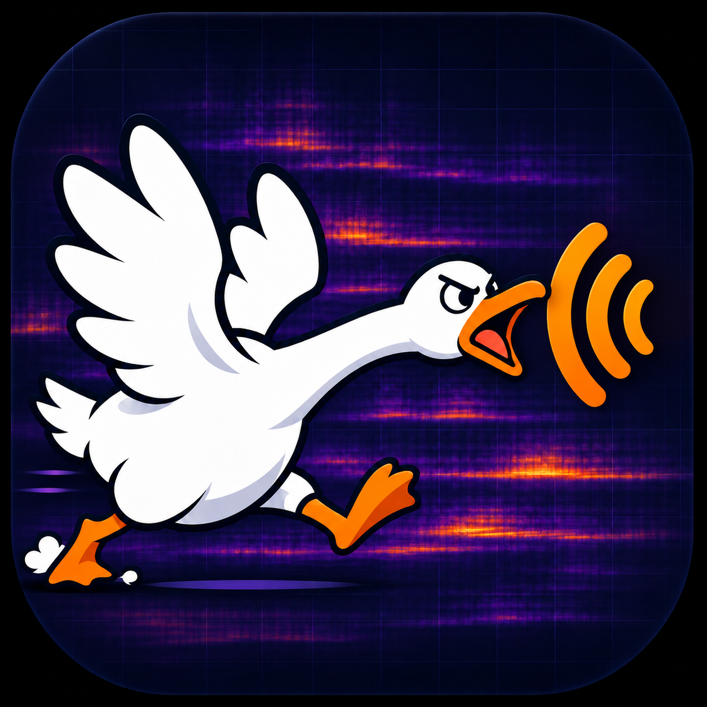

# NoisyGeese

[中英](README.md) · [中文](README.zh-CN.md) · [English](README.en.md)



A browser tool for recording, viewing, and comparing sound locally. The website can be hosted on GitHub Pages; audio, labels, and analysis stay in the current browser and are not uploaded to the repository or a server.

## Features

- Chinese is the default. The language picker is at least 44 px high, supports bilingual / Chinese / English, and restores the saved choice after reload.
- Fit the spectrogram color range once to the selected band, set manual dBFS color limits, or reset them. Frequency axes remain 20 Hz–20 kHz; changing the color range clears old color history. Changing bands during a fit restarts it, and a locked scale does not continuously follow the sound.
- Display pixels retain the strongest FFT bin so narrow high-frequency peaks remain visible. Color contrast cannot recover uncaptured signals: microphone response, device processing, or a weak signal can affect capture. Compare another device or recording setting.
- Default labels use each recording's local start timestamp; manual labels are preserved. Capture and comparison frequency limits synchronize in both directions. Color controls do not change raw PCM, analysis algorithms, the shared threshold, or comparison results.

- The web interface offers three reading modes: bilingual Chinese/English, Chinese, and English.
- Expand “How to use” for illustrated instructions, including an explicitly fictional fifth-floor example and actual UI screenshots.
- Built-in simulated capture requires no microphone. It sends synthetic audio through the real AudioWorklet and IndexedDB pipeline and labels it as simulated data.
- View a live instantaneous spectrum and spectrogram while the microphone is on. The spectrogram shows time horizontally and logarithmic frequency vertically, with high frequencies at the top.
- Drag the upper and lower band limits within a 20 Hz–20 kHz display range, enter values, or fine-tune with arrow keys. Shift + arrow keys adjusts by 10 Hz.
- Record for 5, 10, 20, 30, 60, or 120 seconds, with automatic stopping based on the raw PCM sample count, or stop early. Audio is not normalized.
- Add custom location labels; reorder by dragging, move items up or down, or sort naturally by Chinese floor numbers and Arabic numerals.
- Keep real recordings in IndexedDB so they remain available after a refresh. Synthetic examples stay only in the current page's memory.
- Choose an analysis start point for each recording and compare average energy using the same frequency band and duration.
- Use one adjustable threshold shared across all recordings to divide short windows into event and quiet groups. Calculate their average power separately and show window counts and estimated durations. Show “None” when no windows qualify.
- Play recordings, download WAV files, export/import `.noise` backups containing raw Float32 samples, and export CSV.

## Run locally

No npm dependencies are required. Use a modern browser that supports AudioWorklet, Web Workers, and IndexedDB.

Run this command from the project root:

```sh
python3 -m http.server 8080 --bind 127.0.0.1 --directory dist
```

Then open `http://127.0.0.1:8080`. On Windows, you can use `python` instead of `python3`.

Microphone access requires an HTTPS or localhost secure context. Do not open `index.html` directly with `file://`: the browser may restrict modules and Worklets. The browser will request microphone permission separately. All live audio processing runs locally.

## GitHub Pages

Keep the static site source files in `dist/` and copy their complete contents unchanged to `docs/` for publication. There is no server, build step, or external CDN dependency. After each source edit, sync `dist/` to `docs/`. In the repository’s Settings → Pages, select Deploy from a branch → main → /docs → Save. No Actions workflow is needed. All resource references use relative paths and support project subpaths.

Making the repository and website public does not automatically publish recordings. Recording storage is isolated by browser, device, and site origin, and does not automatically sync across devices. Recordings do not automatically migrate when the domain changes; use backups.

## Analysis method

Comparative analysis uses a radix-2 FFT implemented in this project, without using the interfaces, source code, or analysis libraries of other audio tools.

1. Extract a PCM segment of the same duration from each recording at its specified start point.
2. The FFT length is `2^ceil(log2(sampleRate/6))`. At 48 kHz, this is 8192 samples, or 170.67 ms, with 5.86 Hz frequency resolution. Apply a Hann window with 50% overlap, adding a final full window that ends at the segment boundary.
3. Include frequency bins whose center frequencies fall within the selected band. Correct one-sided spectral energy by `N × sum(window²)` and double it except at the Nyquist endpoint to obtain each short window's band mean-square value.
4. Midpoints between neighboring window centers define the time represented by each window, with the first and last intervals extending to the segment boundaries. Average power using these time weights, then convert to dBFS with `10 log10(power)`. Overlapping windows do not double-count duration.
5. Short windows at or above the shared dBFS threshold are events; those below it are quiet. Average power separately for each group using its represented time. The suggested shared threshold is the dBFS value corresponding to the 20th percentile of short-window power across all valid segments, plus 6 dB. This is only an adjustable starting point, not automatic identification of a sound source.
6. Separately display the maximum short-window level, the FFT bin with the highest average power within the band, the actual effective band, and the number of samples near full scale.

Live previews use the browser’s AnalyserNode. Its window function differs from that used for comparative statistics. The preview is mainly for selecting a band; its amplitudes are not directly interchangeable with the analysis values. The first version uses STFT and does not include a wavelet transform.

## Measurement limitations

- dBFS measures a digital signal relative to full scale. It is **not calibrated dB SPL, dBA, or a regulatory sound level**, and cannot establish whether a noise limit has been exceeded.
- Use the same device, microphone, browser, input gain, orientation, and positioning conditions. The page requests that automatic gain control, noise suppression, and echo cancellation be disabled, but the operating system or hardware may ignore those settings or continue processing.
- Phone low-frequency response, wind, handling noise, background speech, reflections, and structure-borne sound can all affect comparisons. The loudest location does not prove that the source is there.
- Grouping detects energy fluctuations in the selected frequency band. It cannot reliably distinguish narrowband peaks from broadband noise in the same band and is not a sound-source classifier.
- Backgrounding or locking a phone may pause sampling. Keep the page in the foreground and listen back to check continuity.
- For disputes, compliance, or health-related judgments, use calibrated equipment and seek professional measurement.

## Data and privacy

The application code has no audio upload endpoint, third-party analytics scripts, or external CDN. The hosting service still handles ordinary web requests. Real audio and labels are stored in this browser’s IndexedDB; browser storage cleanup, closing a private-browsing window, or clearing site data may remove them.

Export backups regularly. Backups contain audio and labels, so review them before sharing. WAV exports use 16-bit PCM; `.noise` backups preserve the original Float32 PCM. The page asks for confirmation before deleting a recording; deletion cannot be undone.

## Tests

```sh
npm test
```

Tests cover known sine-wave RMS, out-of-band rejection, amplitude steps, silence, short segments, narrow bands containing no bins, clipping candidates, Chinese natural sorting, empty event/quiet groups, conservation of grouped duration, and exact and early Worklet stopping. The browser also includes a built-in calculation self-check.

See [QA.md](QA.md) for details. Numerical algorithm self-checks cannot calibrate a microphone.

## License

This project is licensed under the [Apache License 2.0](LICENSE).

## Why I made this

A strange high-frequency beep would turn up at home during both the day and the night. Sometimes chargers plugged into the wall would make a similar sound. At times I was not even sure whether the sound was really there or I was imagining it.

Trying to track it down by ear was tiring, so I finally asked Dots to help me build this tool: record the sound, see which frequency band it occupies, then compare different locations under the same conditions. At least I would not have to keep guessing by ear.
