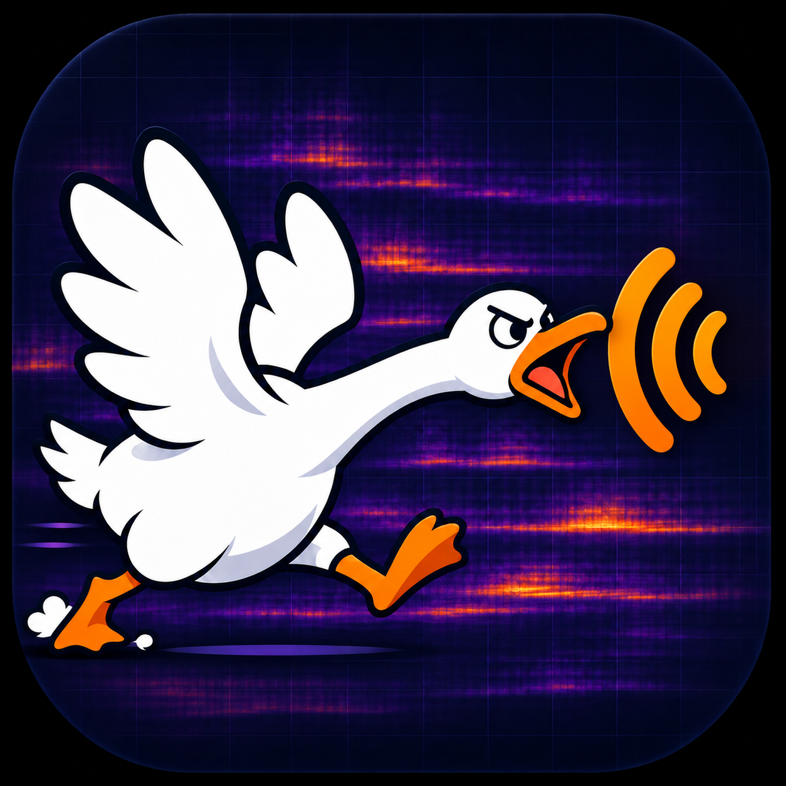

# NoisyGeese 暴噪鹅

[中英](README.md) · [中文](README.zh-CN.md) · [English](README.en.md)



一个在浏览器本地采集、查看与对照声音的工具。网页可以托管在 GitHub Pages；音频、标签与分析留在当前浏览器，不上传到仓库或服务器。  
A browser tool for recording, viewing, and comparing sound locally. The website can be hosted on GitHub Pages; audio, labels, and analysis stay in the current browser and are not uploaded to the repository or a server.

## 可以做什么
## Features

- 默认使用中文；右上角语言选择器至少高 44 px，可切换中英 / 中文 / English，并在刷新后恢复选择。
  Chinese is the default. The language picker is at least 44 px high, supports bilingual / Chinese / English, and restores the saved choice after reload.
- 按选定频段适配一次时频图色阶，或手动设置颜色对应的 dBFS 上下限、恢复默认。频率轴保持 20 Hz–20 kHz；更换色阶会按新颜色重绘保留的历史，不清空时频图；调整画布大小也会重绘保留的历史。拟合期间改变频段会重新开始，固定后的色阶不会连续追随声音。
  Fit the spectrogram color range once to the selected band, set manual dBFS color limits, or reset them. Frequency axes remain 20 Hz–20 kHz; changing the color range redraws the retained history without clearing the spectrogram. Resizing also redraws the retained history. Changing bands during a fit restarts it, and a locked scale does not continuously follow the sound.
- 捕捉高频窄峰时保留显示像素内最强 FFT 格点。颜色只能增强已录入信号的显示，不能恢复未录入的声音；麦克风、设备处理或信号太弱都可能影响捕捉，可用其他设备或设置对照。
  Display pixels retain the strongest FFT bin so narrow high-frequency peaks remain visible. Color contrast cannot recover uncaptured signals: microphone response, device processing, or a weak signal can affect capture. Compare another device or recording setting.
- 默认标签使用每次开始录制的本地时间戳；手动输入的标签会保留。采集和对照区域的频率上下限双向同步。色阶不改变原始 PCM、分析算法、共同阈值或比较结果。
  Default labels use each recording's local start timestamp; manual labels are preserved. Capture and comparison frequency limits synchronize in both directions. Color controls do not change raw PCM, analysis algorithms, the shared threshold, or comparison results.

- 网页界面提供中英 / 中文 / English 三种阅读模式。  
  The web interface offers three reading modes: bilingual Chinese/English, Chinese, and English.
- 展开“使用方法”可查看图文说明，包括明确标注为虚构的五楼示例和实际界面截图。  
  Expand “How to use” for illustrated instructions, including an explicitly fictional fifth-floor example and actual UI screenshots.
- 内置模拟采集无需麦克风，将合成音频送入实际 AudioWorklet 与 IndexedDB 流程，并标注为模拟数据。  
  Built-in simulated capture requires no microphone. It sends synthetic audio through the real AudioWorklet and IndexedDB pipeline and labels it as simulated data.
- 开启麦克风时实时查看瞬时频谱和时频图。时频图横轴是时间，纵轴是对数频率，高频在上；以约 12 秒的有限窗口持续滚动，旧画面逐步移出，不周期性清空。未录制时只保留短时显示数据，不保存原始音频；后台或缺失采样的时间留空。  
  View a live instantaneous spectrum and spectrogram while the microphone is on. The spectrogram shows time horizontally and logarithmic frequency vertically, with high frequencies at the top. An approximately 12-second bounded window scrolls continuously, moving older content out without periodic resets. When not recording, only short-lived display data is retained, not raw audio. Missing or background sampling intervals stay blank.
- 在 20 Hz–20 kHz 显示范围内拖动频段上下边界，也可输入数值或用方向键微调，Shift + 方向键调整 10 Hz。  
  Drag the upper and lower band limits within a 20 Hz–20 kHz display range, enter values, or fine-tune with arrow keys. Shift + arrow keys adjusts by 10 Hz.
- 设置 5、10、20、30、60 或 120 秒录制，按原始 PCM 样本数自动停止，也可提前结束。音频未做归一化。  
  Record for 5, 10, 20, 30, 60, or 120 seconds, with automatic stopping based on the raw PCM sample count, or stop early. Audio is not normalized.
- 自定义位置标签；拖动排序、上下移动，或按中文楼层数字和阿拉伯数字自然排序。  
  Add custom location labels; reorder by dragging, move items up or down, or sort naturally by Chinese floor numbers and Arabic numerals.
- 在 IndexedDB 中保留真实录音，刷新后仍可读取。示例是合成信号，只保留在当前页面内存。  
  Keep real recordings in IndexedDB so they remain available after a refresh. Synthetic examples stay only in the current page's memory.
- 为每条记录选择分析起点，用同一频带、同一长度比较平均能量。  
  Choose an analysis start point for each recording and compare average energy using the same frequency band and duration.
- 使用所有记录共用的可调阈值，将短窗分成事件段和安静段，分别计算功率平均值，显示窗数与估计时长。无符合短窗时显示“无”。  
  Use one adjustable threshold shared across all recordings to divide short windows into event and quiet groups. Calculate their average power separately and show window counts and estimated durations. Show “None” when no windows qualify.
- 回听、下载 WAV、导出/导入包含原始 Float32 采样的 `.noise` 备份、导出 CSV。  
  Play recordings, download WAV files, export/import `.noise` backups containing raw Float32 samples, and export CSV.

- “开启麦克风”和“开始录制”位于“如何使用”下方、状态提示与频谱图上方。图内颜色范围上方显示当前分析频段，随拖动边界、键盘或数值输入同步更新。  
  The microphone and recording buttons sit below “How to use” and above the status and spectrum. The current analysis band appears inside the instrument above the color range and updates with dragging, keyboard adjustments, or numeric input.
- 每条录音可进行图形回放，默认静音且循环播放；支持暂停/继续、从头播放、拖动进度、可选播放声音和返回实时。回放整条录音，不改变分析起点、原始音频或统计结果。普通循环不重置历史；从头播放或跳转进度会重新开始回放图形。  
  Each recording supports visual replay, silent and looping by default, with pause/resume, restart, seeking, optional sound, and a return to live mode. Replay uses the full recording without changing analysis start points, original audio, or statistics. Normal loop boundaries preserve the rolling history; restart and seek start a fresh replay graph.
- 输入指定频率生成正弦纯音试听。默认 5413 Hz、−36 dBFS，带淡入淡出；可手动停止，每次最多 15 秒，离开页面时停止。录制期间不能试听，开始录制会先停止纯音。请先调低设备/耳机音量，不适时立即停止；数字电平不等于实际声压级，麦克风也可能收到测试音。  
  Enter a frequency to preview a sine tone. Defaults are 5413 Hz and −36 dBFS, with fade-in/fade-out. Stop manually or let it stop after at most 15 seconds; leaving the page stops it. Tone playback is blocked while recording, and starting a recording stops the tone first. Start with low device/headphone volume and stop if uncomfortable. Digital level is not acoustic sound pressure, and the microphone may pick up the tone.
- 声音记录支持多选删除，删除选择与对照选择分开。确认弹窗列出所选数量和名称；取消不会删除，确认只删除所选记录，保留未选记录。删除不可撤销，请先导出要保留的录音。  
  Delete multiple recordings using a selection separate from comparison selection. A confirmation dialog lists the selected count and names. Cancel deletes nothing; confirmation deletes only the selected recordings and preserves unselected ones. Deletion cannot be undone, so export anything you want to keep first.
- 下方对照区域名为“音量分析”，分析频段说明为“分析频段：设置为噪音所在的频段”。  
  The comparison section is labeled “Volume analysis”; its band instruction is “Analysis band: select the band containing the noise.”

## 本地运行
## Run locally

不需要安装 npm 依赖。需要一个支持 AudioWorklet、Web Workers 和 IndexedDB 的现代浏览器。  
No npm dependencies are required. Use a modern browser that supports AudioWorklet, Web Workers, and IndexedDB.

在项目根目录运行：  
Run this command from the project root:

```sh
python3 -m http.server 8080 --bind 127.0.0.1 --directory dist
```

然后打开 `http://127.0.0.1:8080`。Windows 可使用 `python` 替代 `python3`。  
Then open `http://127.0.0.1:8080`. On Windows, you can use `python` instead of `python3`.

麦克风只在 HTTPS 或 localhost 安全上下文可用。请不要直接双击 `index.html` 使用 `file://`，模块和 Worklet 可能被浏览器限制。浏览器会单独请求麦克风权限。所有现场音频处理都在本机执行。  
Microphone access requires an HTTPS or localhost secure context. Do not open `index.html` directly with `file://`: the browser may restrict modules and Worklets. The browser will request microphone permission separately. All live audio processing runs locally.

## GitHub Pages
## GitHub Pages

静态站点源文件保留在 `dist/`，将其全部静态内容原样复制到 `docs/` 用于发布。没有服务端、构建步骤或外部 CDN 依赖。每次修改源文件后，请同步 `dist/` 到 `docs/`。在仓库 Settings → Pages 中选择 Deploy from a branch → main → /docs → Save，无需 Actions 工作流。所有资源引用均为相对路径，支持项目子路径。  
Keep the static site source files in `dist/` and copy their complete contents unchanged to `docs/` for publication. There is no server, build step, or external CDN dependency. After each source edit, sync `dist/` to `docs/`. In the repository’s Settings → Pages, select Deploy from a branch → main → /docs → Save. No Actions workflow is needed. All resource references use relative paths and support project subpaths.

仓库与网页公开并不自动公开录音。录音存储按浏览器、设备和站点来源隔离，不会自动跨设备同步。更换域名后原站点录音不会自动迁移，请使用备份。  
Making the repository and website public does not automatically publish recordings. Recording storage is isolated by browser, device, and site origin, and does not automatically sync across devices. Recordings do not automatically migrate when the domain changes; use backups.

## 分析方法
## Analysis method

正式对照使用本项目实现的 radix-2 FFT，不使用其他音频工具的界面、源代码或分析库。  
Comparative analysis uses a radix-2 FFT implemented in this project, without using the interfaces, source code, or analysis libraries of other audio tools.

1. 每条记录按指定起点截取同长度 PCM 片段。  
  Extract a PCM segment of the same duration from each recording at its specified start point.
2. FFT 长度为 `2^ceil(log2(sampleRate/6))`。在 48 kHz 下为 8192 点，即 170.67 ms，频率分辨率为 5.86 Hz。使用 Hann 窗与 50% 重叠；末尾补充一个以片段终点结束的完整窗。  
  The FFT length is `2^ceil(log2(sampleRate/6))`. At 48 kHz, this is 8192 samples, or 170.67 ms, with 5.86 Hz frequency resolution. Apply a Hann window with 50% overlap, adding a final full window that ends at the segment boundary.
3. 对落入频带的频率格点按中心频率纳入。单侧频谱能量按 `N × sum(window²)` 校正，除 Nyquist 端点外加倍，得到短窗频带均方值。  
  Include frequency bins whose center frequencies fall within the selected band. Correct one-sided spectral energy by `N × sum(window²)` and double it except at the Nyquist endpoint to obtain each short window's band mean-square value.
4. 相邻窗中心的中点划定各窗代表的时间，首尾延伸至片段边界。按该时间加权平均功率，最后用 `10 log10(power)` 转为 dBFS。重叠窗不会重复累计时长。  
  Midpoints between neighboring window centers define the time represented by each window, with the first and last intervals extending to the segment boundaries. Average power using these time weights, then convert to dBFS with `10 log10(power)`. Overlapping windows do not double-count duration.
5. 短窗 dBFS 大于或等于共同阈值为事件，低于阈值为安静，各自按代表时间平均功率。“建议共同阈值”为所有有效片段短窗功率第 20 百分位对应 dBFS 加 6 dB。这只是可调整的起点，不代表自动识别了声源。  
  Short windows at or above the shared dBFS threshold are events; those below it are quiet. Average power separately for each group using its represented time. The suggested shared threshold is the dBFS value corresponding to the 20th percentile of short-window power across all valid segments, plus 6 dB. This is only an adjustable starting point, not automatic identification of a sound source.
6. 单独显示短窗最大值、频带内平均功率最高的 FFT 格点、实际有效频带，以及接近满量程的样本数。  
  Separately display the maximum short-window level, the FFT bin with the highest average power within the band, the actual effective band, and the number of samples near full scale.

实时预览使用浏览器 AnalyserNode。预览窗函数与正式统计不同，预览主要用于选择频段，幅度不能直接与正式数值互换。首版使用 STFT，不包含小波变换。  
Live previews use the browser’s AnalyserNode. Its window function differs from that used for comparative statistics. The preview is mainly for selecting a band; its amplitudes are not directly interchangeable with the analysis values. The first version uses STFT and does not include a wavelet transform.

## 测量边界
## Measurement limitations

- dBFS 是数字信号相对满量程的量，**不是经过校准的 dB SPL、dBA 或合规声级**。不能据此判断是否超标。  
  dBFS measures a digital signal relative to full scale. It is **not calibrated dB SPL, dBA, or a regulatory sound level**, and cannot establish whether a noise limit has been exceeded.
- 使用同一设备、麦克风、浏览器、输入增益、方向和位置条件。网页请求关闭自动增益、降噪和回声消除，但操作系统或硬件可能忽略设置或继续处理。  
  Use the same device, microphone, browser, input gain, orientation, and positioning conditions. The page requests that automatic gain control, noise suppression, and echo cancellation be disabled, but the operating system or hardware may ignore those settings or continue processing.
- 手机低频响应、风、手持噪声、背景谈话、反射和结构传声都会影响比较。最响的位置不能证明声源就在该处。  
  Phone low-frequency response, wind, handling noise, background speech, reflections, and structure-borne sound can all affect comparisons. The loudest location does not prove that the source is there.
- 分组算法检测的是所选频段能量起伏。它不能保证区分窄带尖峰与同频段宽带杂声，也不是声源分类器。  
  Grouping detects energy fluctuations in the selected frequency band. It cannot reliably distinguish narrowband peaks from broadband noise in the same band and is not a sound-source classifier.
- 手机切入后台或锁屏可能暂停采样。请让页面保持前台并回听确认连续性。  
  Backgrounding or locking a phone may pause sampling. Keep the page in the foreground and listen back to check continuity.
- 涉及争议、合规或健康判断时，应使用校准设备并寻求专业测量。  
  For disputes, compliance, or health-related judgments, use calibrated equipment and seek professional measurement.

## 数据与隐私
## Data and privacy

应用代码没有音频上传接口、第三方分析脚本或外部 CDN。托管服务仍会处理正常网页访问请求。真实音频和标签保存在本浏览器的 IndexedDB；浏览器清理空间、无痕窗口关闭或用户清理站点数据可能使其丢失。  
The application code has no audio upload endpoint, third-party analytics scripts, or external CDN. The hosting service still handles ordinary web requests. Real audio and labels are stored in this browser’s IndexedDB; browser storage cleanup, closing a private-browsing window, or clearing site data may remove them.

请定期导出备份。备份包含声音及标签，分享前请自行检查。WAV 导出为 16-bit PCM；`.noise` 备份保留原始 Float32 PCM。删除记录前页面会确认，删除不能撤销。  
Export backups regularly. Backups contain audio and labels, so review them before sharing. WAV exports use 16-bit PCM; `.noise` backups preserve the original Float32 PCM. The page asks for confirmation before deleting a recording; deletion cannot be undone.

## 测试
## Tests

```sh
npm test
```

覆盖已知正弦波 RMS、带外抑制、阶跃幅度、零信号、短片段、窄带无格点、削波候选、中文自然排序、事件/安静空集合、分组时长守恒、Worklet 精确停止及提前停止。浏览器中还有“内置计算自检”。  
Tests cover known sine-wave RMS, out-of-band rejection, amplitude steps, silence, short segments, narrow bands containing no bins, clipping candidates, Chinese natural sorting, empty event/quiet groups, conservation of grouped duration, and exact and early Worklet stopping. The browser also includes a built-in calculation self-check.

新增测试覆盖有限滚动历史与调色保留、回放循环/暂停/跳转、纯音边界/渐变/自动停止、删除选择隔离与存储事务，以及选频拖动同步和控件位置。  
Additional tests cover bounded rolling history and recoloring, replay looping/pause/seeking, tone limits/ramps/automatic stopping, deletion-selection isolation and storage transactions, and synchronization of band dragging and control placement.

详见 [QA.md](QA.md)。数字算法自检不能校准麦克风。  
See [QA.md](QA.md) for details. Numerical algorithm self-checks cannot calibrate a microphone.

## 许可证
## License

本项目采用 [Apache License 2.0](LICENSE)。  
This project is licensed under the [Apache License 2.0](LICENSE).

## 为什么做这个
## Why I made this

家里白天、夜里都会冒出一种奇怪的高频蜂鸣，插座上的充电器偶尔也会发出类似的声音。有时我甚至不确定，到底是真有声音，还是自己听错了。  
A strange high-frequency beep would turn up at home during both the day and the night. Sometimes chargers plugged into the wall would make a similar sound. At times I was not even sure whether the sound was really there or I was imagining it.

光靠耳朵来回找实在太累，所以最后请 Dots 帮我做了这个工具：先把声音录下来，看看它在哪个频段，再用同样的条件比较不同位置。至少不用一直凭感觉猜。  
Trying to track it down by ear was tiring, so I finally asked Dots to help me build this tool: record the sound, see which frequency band it occupies, then compare different locations under the same conditions. At least I would not have to keep guessing by ear.

## 作者实测与录音导出
## Author field test and audio export

作者进行过一次实际使用测试，在频谱中观察到约 **5413 Hz** 的间歇性“滴滴滴”噪声候选峰。这是一次实测中的频率线索，尚未确定噪声源，也不代表声级校准或所有设备上的性能验证。  
The author has carried out one real-use test and observed a candidate peak near **5413 Hz** associated with an intermittent beeping noise in the spectrum. This is a frequency clue from a single test, not an identified noise source, sound-level calibration, or performance validation across all devices.

当前网页可导出包含录音的 `.noise` 备份，其中保留原始 Float32 PCM 采样及标签；也可单独下载 WAV 音频。CSV 导出仅包含分析结果，不包含录音。录音不会因为仓库和网页公开而自动上传；分享备份前请检查其中的声音与标签。  
The current web app can export `.noise` backups containing recordings, preserving the original Float32 PCM samples and labels. Recordings can also be downloaded separately as WAV audio. CSV exports contain analysis results only, not audio. A public repository and website do not automatically upload recordings; review the audio and labels before sharing a backup.
