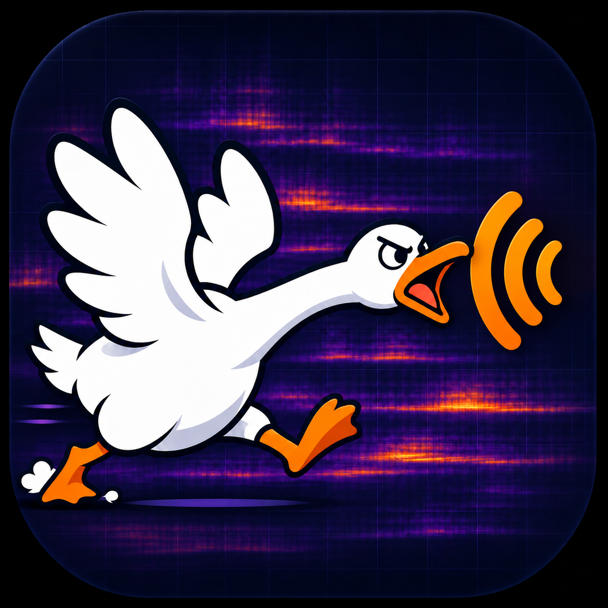

# NoisyGeese 暴噪鹅

[中英](README.md) · [中文](README.zh-CN.md) · [English](README.en.md)



一个在浏览器本地采集、查看与对照声音的工具。网页可以托管在 GitHub Pages；音频、标签与分析留在当前浏览器，不上传到仓库或服务器。

## 可以做什么

- 默认使用中文；右上角语言选择器至少高 44 px，可切换中英 / 中文 / English，并在刷新后恢复选择。
- 按选定频段适配一次时频图色阶，或手动设置颜色对应的 dBFS 上下限、恢复默认。频率轴保持 20 Hz–20 kHz；更换色阶会清空旧颜色历史。拟合期间改变频段会重新开始，固定后的色阶不会连续追随声音。
- 捕捉高频窄峰时保留显示像素内最强 FFT 格点。颜色只能增强已录入信号的显示，不能恢复未录入的声音；麦克风、设备处理或信号太弱都可能影响捕捉，可用其他设备或设置对照。
- 默认标签使用每次开始录制的本地时间戳；手动输入的标签会保留。采集和对照区域的频率上下限双向同步。色阶不改变原始 PCM、分析算法、共同阈值或比较结果。

- 网页界面提供中英 / 中文 / English 三种阅读模式。
- 展开“使用方法”可查看图文说明，包括明确标注为虚构的五楼示例和实际界面截图。
- 内置模拟采集无需麦克风，将合成音频送入实际 AudioWorklet 与 IndexedDB 流程，并标注为模拟数据。
- 开启麦克风时实时查看瞬时频谱和时频图。时频图横轴是时间，纵轴是对数频率，高频在上。
- 在 20 Hz–20 kHz 显示范围内拖动频段上下边界，也可输入数值或用方向键微调，Shift + 方向键调整 10 Hz。
- 设置 5、10、20、30、60 或 120 秒录制，按原始 PCM 样本数自动停止，也可提前结束。音频未做归一化。
- 自定义位置标签；拖动排序、上下移动，或按中文楼层数字和阿拉伯数字自然排序。
- 在 IndexedDB 中保留真实录音，刷新后仍可读取。示例是合成信号，只保留在当前页面内存。
- 为每条记录选择分析起点，用同一频带、同一长度比较平均能量。
- 使用所有记录共用的可调阈值，将短窗分成事件段和安静段，分别计算功率平均值，显示窗数与估计时长。无符合短窗时显示“无”。
- 回听、下载 WAV、导出/导入包含原始 Float32 采样的 `.noise` 备份、导出 CSV。

## 本地运行

不需要安装 npm 依赖。需要一个支持 AudioWorklet、Web Workers 和 IndexedDB 的现代浏览器。

在项目根目录运行：

```sh
python3 -m http.server 8080 --bind 127.0.0.1 --directory dist
```

然后打开 `http://127.0.0.1:8080`。Windows 可使用 `python` 替代 `python3`。

麦克风只在 HTTPS 或 localhost 安全上下文可用。请不要直接双击 `index.html` 使用 `file://`，模块和 Worklet 可能被浏览器限制。浏览器会单独请求麦克风权限。所有现场音频处理都在本机执行。

## GitHub Pages

静态站点源文件保留在 `dist/`，将其全部静态内容原样复制到 `docs/` 用于发布。没有服务端、构建步骤或外部 CDN 依赖。每次修改源文件后，请同步 `dist/` 到 `docs/`。在仓库 Settings → Pages 中选择 Deploy from a branch → main → /docs → Save，无需 Actions 工作流。所有资源引用均为相对路径，支持项目子路径。

仓库与网页公开并不自动公开录音。录音存储按浏览器、设备和站点来源隔离，不会自动跨设备同步。更换域名后原站点录音不会自动迁移，请使用备份。

## 分析方法

正式对照使用本项目实现的 radix-2 FFT，不使用其他音频工具的界面、源代码或分析库。

1. 每条记录按指定起点截取同长度 PCM 片段。
2. FFT 长度为 `2^ceil(log2(sampleRate/6))`。在 48 kHz 下为 8192 点，即 170.67 ms，频率分辨率为 5.86 Hz。使用 Hann 窗与 50% 重叠；末尾补充一个以片段终点结束的完整窗。
3. 对落入频带的频率格点按中心频率纳入。单侧频谱能量按 `N × sum(window²)` 校正，除 Nyquist 端点外加倍，得到短窗频带均方值。
4. 相邻窗中心的中点划定各窗代表的时间，首尾延伸至片段边界。按该时间加权平均功率，最后用 `10 log10(power)` 转为 dBFS。重叠窗不会重复累计时长。
5. 短窗 dBFS 大于或等于共同阈值为事件，低于阈值为安静，各自按代表时间平均功率。“建议共同阈值”为所有有效片段短窗功率第 20 百分位对应 dBFS 加 6 dB。这只是可调整的起点，不代表自动识别了声源。
6. 单独显示短窗最大值、频带内平均功率最高的 FFT 格点、实际有效频带，以及接近满量程的样本数。

实时预览使用浏览器 AnalyserNode。预览窗函数与正式统计不同，预览主要用于选择频段，幅度不能直接与正式数值互换。首版使用 STFT，不包含小波变换。

## 测量边界

- dBFS 是数字信号相对满量程的量，**不是经过校准的 dB SPL、dBA 或合规声级**。不能据此判断是否超标。
- 使用同一设备、麦克风、浏览器、输入增益、方向和位置条件。网页请求关闭自动增益、降噪和回声消除，但操作系统或硬件可能忽略设置或继续处理。
- 手机低频响应、风、手持噪声、背景谈话、反射和结构传声都会影响比较。最响的位置不能证明声源就在该处。
- 分组算法检测的是所选频段能量起伏。它不能保证区分窄带尖峰与同频段宽带杂声，也不是声源分类器。
- 手机切入后台或锁屏可能暂停采样。请让页面保持前台并回听确认连续性。
- 涉及争议、合规或健康判断时，应使用校准设备并寻求专业测量。

## 数据与隐私

应用代码没有音频上传接口、第三方分析脚本或外部 CDN。托管服务仍会处理正常网页访问请求。真实音频和标签保存在本浏览器的 IndexedDB；浏览器清理空间、无痕窗口关闭或用户清理站点数据可能使其丢失。

请定期导出备份。备份包含声音及标签，分享前请自行检查。WAV 导出为 16-bit PCM；`.noise` 备份保留原始 Float32 PCM。删除记录前页面会确认，删除不能撤销。

## 测试

```sh
npm test
```

覆盖已知正弦波 RMS、带外抑制、阶跃幅度、零信号、短片段、窄带无格点、削波候选、中文自然排序、事件/安静空集合、分组时长守恒、Worklet 精确停止及提前停止。浏览器中还有“内置计算自检”。

详见 [QA.md](QA.md)。数字算法自检不能校准麦克风。

## 许可证

本项目采用 [Apache License 2.0](LICENSE)。

## 为什么做这个

家里白天、夜里都会冒出一种奇怪的高频蜂鸣，插座上的充电器偶尔也会发出类似的声音。有时我甚至不确定，到底是真有声音，还是自己听错了。

光靠耳朵来回找实在太累，所以最后请 Dots 帮我做了这个工具：先把声音录下来，看看它在哪个频段，再用同样的条件比较不同位置。至少不用一直凭感觉猜。
